<a href="https://barisparlak.com">
  
</a>

  
  
  
  

<a href="https://barisparlak.com/#work">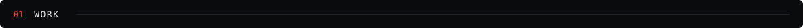</a>

  <a href="https://github.com/barisparlakk/Seyir">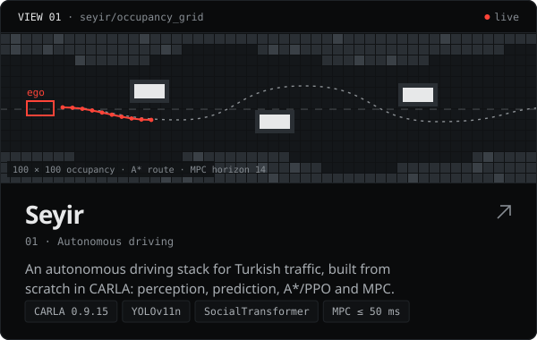</a>
  <a href="https://github.com/barisparlakk/DeepDerm"></a>

  <a href="https://github.com/barisparlakk/TurkRAG">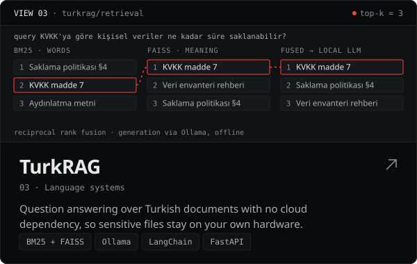</a>
  <a href="https://github.com/barisparlakk/thermground"></a>

  <a href="https://github.com/barisparlakk/skyguard-edge-detection">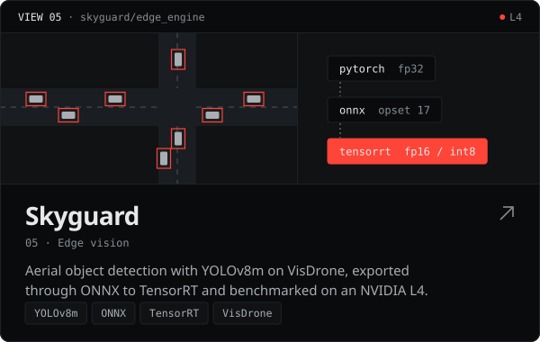</a>
  <a href="https://github.com/barisparlakk/Notary">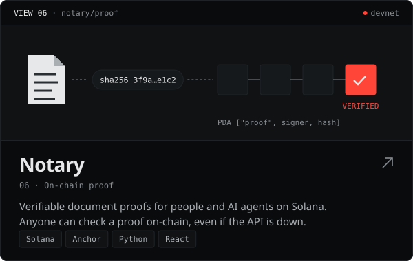</a>

<a href="https://barisparlak.com/#experience">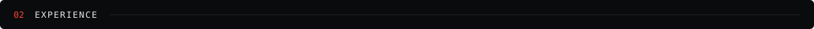</a>

<a href="https://barisparlak.com/#experience">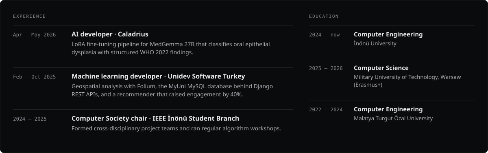</a>

<a href="https://barisparlak.com/#toolkit">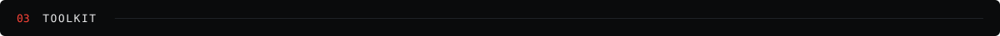</a>

<a href="https://barisparlak.com/#toolkit">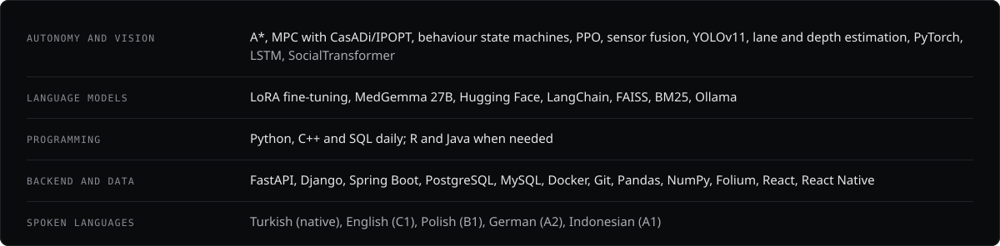</a>

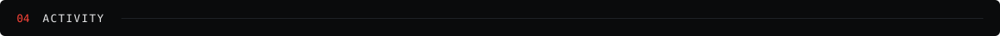

<picture>
  <source media="(prefers-color-scheme: dark)" srcset="https://raw.githubusercontent.com/barisparlakk/barisparlakk/output/snake-dark.svg" />
  
</picture>

I'm looking for roles in AI, autonomy and data · <a href="https://barisparlak.com">barisparlak.com</a>

