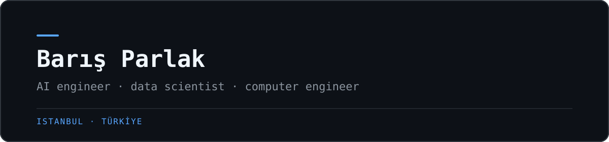

  

 

  
  
  

## Profile

I build applied AI systems that move from experiments to usable products. My work focuses on computer vision, retrieval-augmented generation, anomaly detection, and data-driven software.

- Based in Istanbul, Türkiye
- Working across AI engineering, data science, and computer engineering
- Currently exploring edge inference, privacy-first RAG, and intelligent mobility
- Open to research, engineering, and product collaborations

## Technologies

  

 

  
  
  
  
  

## GitHub activity

  
  

  

## Selected work

<table>
  <tr>
    <td width="50%" valign="top">
      <h3><a href="https://github.com/barisparlakk/skyguard-edge-detection">Skyguard Edge Detection</a></h3>
      
Real-time aerial object detection optimized for edge deployment with YOLOv8, ONNX, and TensorRT.

      <code>Computer vision</code> <code>Edge AI</code> <code>TensorRT</code>
    </td>
    <td width="50%" valign="top">
      <h3><a href="https://github.com/barisparlakk/TurkRAG">TurkRAG</a></h3>
      
Privacy-first, on-premise retrieval-augmented generation designed for Turkish business documents.

      <code>Python</code> <code>RAG</code> <code>LLM</code>
    </td>
  </tr>
  <tr>
    <td width="50%" valign="top">
      <h3><a href="https://github.com/barisparlakk/ecu-anomaly-detection">ECU Anomaly Detection</a></h3>
      
Real-time engine anomaly detection using an LSTM autoencoder trained on normal OBD-II sensor data.

      <code>Python</code> <code>LSTM</code> <code>Time series</code>
    </td>
    <td width="50%" valign="top">
      <h3><a href="https://github.com/barisparlakk/Seyir">Seyir</a></h3>
      
An end-to-end autonomous driving pipeline designed around Turkish traffic characteristics.

      <code>Python</code> <code>Autonomous driving</code> <code>Vision</code>
    </td>
  </tr>
</table>

---

  Building reliable intelligent systems from data to deployment.

