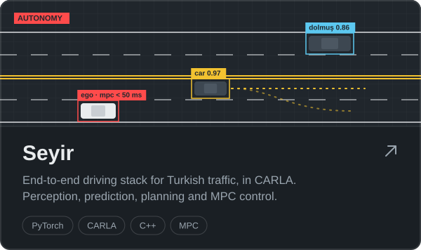
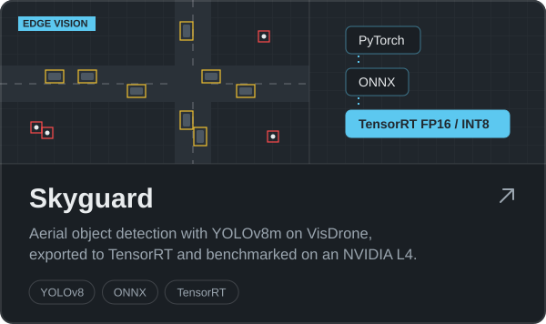
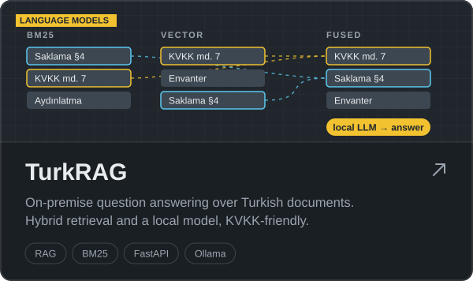
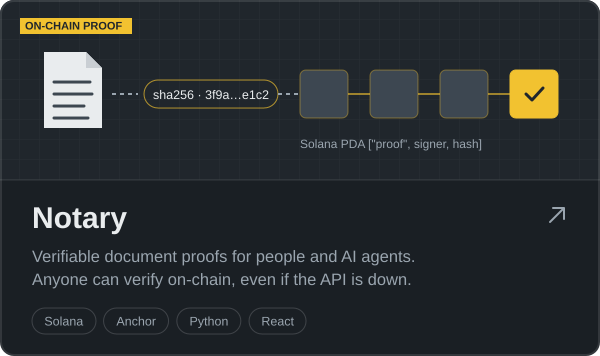

  
  
  
  

I build perception, planning and language systems, and I like taking them all the way: past the notebook, into a simulator, onto an edge GPU or behind an API someone actually uses. I study computer engineering at İnönü University and spent 2025–26 at the Military University of Technology in Warsaw.

## Projects

  
  

  
  

  
  

## Experience

| | | |
|:--|:--|--:|
| **AI developer** | Caladrius · LoRA fine-tuning of MedGemma 27B for oral dysplasia grading | `2026` |
| **ML developer** | Unidev Software · geospatial analysis, Django APIs, a recommender that lifted engagement 40% | `2025` |
| **Computer Society chair** | IEEE İnönü Student Branch · project teams and algorithm workshops | `2024–25` |

## Toolkit

  

also TensorRT · ONNX · CARLA · CasADi · Hugging Face · LangChain · FAISS · Ollama

<picture>
  <source media="(prefers-color-scheme: dark)" srcset="https://raw.githubusercontent.com/barisparlakk/barisparlakk/output/snake-dark.svg" />
  
</picture>
